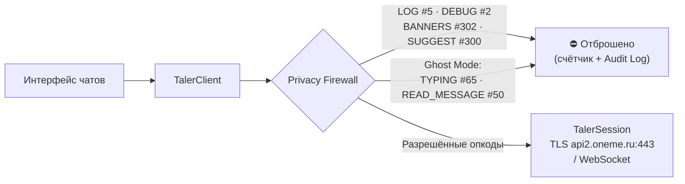

<div align="center">


# Taler

**Открытый клиент мессенджера MAX с нулевой телеметрией**

*Написан с нуля на чистом Flutter / Dart — без проприетарных SDK, без патчинга оригинального клиента и без слежки.*

[](https://github.com/grentu/Taler/releases/latest)
[](https://github.com/grentu/Taler/actions/workflows/build.yml)
[](LICENSE)
[](#-скачать)

[Скачать](#-скачать) · [Privacy Shield](#-privacy-shield-и-блокировка-телеметрии) · [Интерфейс](#-интерфейс-и-возможности) · [Архитектура](#-архитектура) · [Сборка](#-сборка-из-исходников) · [FAQ](#-частые-вопросы)

</div>

---

## О проекте

Официальный клиент MAX (`api.oneme.ru`) собирает диагностику, события интерфейса, аппаратные отпечатки устройства, параметры окружения и синхронизирует рекламные баннеры.

**Taler** полностью переписан **с нуля на чистом Dart и Flutter** по открытой спецификации бинарного протокола MAX из проекта [`KometTeam/Komet`](https://github.com/KometTeam/Komet):

- Ни одна проприетарная библиотека, обфусцированный модуль или SDK оригинала в сборке не используется.
- Весь сетевой стек (**TLS-сокет** + **WebSocket fallback** + **10-байтовый фрейминг** + **MessagePack** + **LZ4**) открыт и проверяется до байта.
- Встроенный **Privacy Firewall** физически не пропускает пакеты телеметрии и баннеров до сокета.

---

## 📦 Скачать

Актуальные готовые сборки под все платформы публикуются автоматически на странице [**Releases**](https://github.com/grentu/Taler/releases/latest):

| Платформа | Файл в релизе | Примечание |
| :--- | :--- | :--- |
| **Android (новый телефон)** | `Taler-Android-arm64-v8a.apk` | **Рекомендуется** для всех современных 64-битных смартфонов |
| **Android (старый 32-bit)** | `Taler-Android-armeabi-v7a.apk` | Для бюджетных/старых устройств на 32-битном ARM |
| **Android (эмулятор ПК)** | `Taler-Android-x86_64.apk` | Для эмуляторов на x86_64 |
| **Windows (x64)** | `Taler-Windows-x64.exe` | Один исполняемый файл без установки и архивов |
| **iPhone / iPad (iOS)** | `Taler-iOS-unsigned.ipa` | Установка через AltStore, SideStore, Sideloadly или TrollStore |

---

## 🛡️ Privacy Shield и блокировка телеметрии

Каждый пакет, проходящий через Taler, фильтруется шлюзом [`PrivacyFirewall`](lib/core/privacy/privacy_firewall.dart) **до попадания в TLS/WebSocket-сокет**:



### Жёстко заблокированные опкоды (неотключаемые)

| Opcode | Имя | Направление | Поведение Taler |
| :---: | :--- | :--- | :--- |
| `2` | `DEBUG` | Outgoing | **Жёстко заблокирован** (`blockedTelemetry`) |
| `5` | `LOG` | Outgoing | **Жёстко заблокирован** (`blockedTelemetry`) |
| `300` | `CHAT_SUGGEST` | Outgoing | **Жёстко заблокирован** (аналитика и подсказки) |
| `302` | `BANNERS_SYNC` | Outgoing | **Жёстко заблокирован** (синхронизация баннеров) |
| `292` | `NOTIF_BANNERS` | Incoming | **Отбрасывается на входе** до парсинга |

### Управляемые функции приватности

| Функция | Что делает |
| :--- | :--- |
| **Ghost Mode (Невидимка)** | Отправляет `interactive: false` в keepalive `PING #1`, чтобы не светить онлайн-статус |
| **Скрытие набора текста** | Режет исходящие пакеты `MSG_TYPING #65` на уровне файрвола |
| **Anti-Read** | Блокирует отправку `CHAT_MARK #50` (`READ_MESSAGE`) — можно читать переписки незаметно |
| **Anti-Delete** | Перехватывает удаления собеседником (`NOTIF_MESSAGE REMOVED`, `NOTIF_MSG_DELETE #142`, `NOTIF_MSG_DELETE_RANGE #140`) и сохраняет текст локально с пометкой корзины |
| **Edit History** | Локально хранит предыдущие версии отредактированных сообщений с точным временем правки |
| **Device Spoofing** | Подставляет виртуальный профиль устройства при рукопожатии (`SESSION_INIT #6`), не читая реальные ID железа; при необходимости отключается на экране входа |
| **Wire Audit Log** | Встроенный кольцевой инспектор трафика в реальном времени с просмотром полезной нагрузки |

---

## ✨ Интерфейс и возможности

- **Адаптивный UI под ПК и телефон**:
  - **Windows / Desktop**: узкое левое меню-рейл, список чатов `360 px` с вкладками папок и счётчиками, лента переписки до `760 px` и сворачиваемая боковая панель профиля/группы (`≥ 1100 px`).
  - **Android / iOS**: полноэкранный список чатов и плавающее полупрозрачное меню-островок (`Чаты` · `Защита` · `Профиль`).
- **Надёжная переписка**:
  - Склейка подряд идущих сообщений одного автора, разделители дат, быстрые реакции, ответы, отправка фото и файлов с автоматическим повтором при `not.ready`.
  - Честные индикаторы статуса: ожидание (`🕒`), отправлено (`✓`), прочитано (`✓✓` по `NOTIF_MARK`), ошибка отправки (красный значок `!` и повтор по нажатию).
  - Автоматическое подтягивание имён и аватарок собеседников без контакта через `CONTACT_INFO #32`.
- **Тёмная и светлая темы** со шрифтами **Geist** и **GeistMono** (лицензия SIL OFL 1.1).
- **Демо-режим (Песочница)**: позволяет сразу протестировать интерфейс, Anti-Delete, историю правок и Wire Audit Log без входа в аккаунт.

---

## 🧩 Архитектура

```text
lib/
├── main.dart                         # Точка входа, темы и wakeUp при возврате из фона
├── backend/
│   └── taler_client.dart             # Клиент MAX: авторизация, чаты, сообщения, пуши, демо
├── core/
│   ├── protocol/                     # Чистая Dart-реализация бинарного протокола MAX
│   │   ├── opcode.dart               # Карта опкодов (auth, chats, messages, telemetry)
│   │   ├── msgpack.dart              # Сериализатор и декодер MessagePack
│   │   ├── lz4.dart                  # Декомпрессор LZ4-блоков и LZ4-фреймов
│   │   ├── packet.dart               # 10-байтовый big-endian фрейминг (ver = 10)
│   │   └── fingerprint.dart          # Вычисление отпечатка кэша для LOGIN / AUTH_REQUEST
│   ├── privacy/                      # Слой приватности и маскировки
│   │   ├── privacy_settings.dart     # Настройки Ghost Mode, Anti-Read, Anti-Delete
│   │   ├── spoof_profile.dart        # Модель и сериализация виртуальных устройств
│   │   ├── spoofing_service.dart     # Пресеты и генерация случайных отпечатков
│   │   └── privacy_firewall.dart     # Фильтр исходящих/входящих пакетов + Wire Audit Log
│   ├── transport/
│   │   └── taler_session.dart        # Прямой TLS-сокет + fallback WebSocket, ping и реконнект
│   └── storage/
│       ├── taler_models.dart         # Модели профилей, контактов, чатов, сообщений, папок
│       └── local_store.dart          # Локальный кэш, Anti-Delete и история правок
└── ui/
    ├── icons/                        # Векторные иконки Lucide с морфингом (taler_icon)
    ├── theme/                        # Палитры (taler_theme) и чат-токены (chat_tokens)
    ├── widgets/                      # Пузыри, список чатов, инфо-панель, логотип TalerLogo
    └── screens/                      # Авторизация, главная, чат, Privacy Shield, настройки
```

---

## 🛠️ Сборка из исходников

### Требования
- **Flutter SDK** (`stable`, Dart `^3.10.0`)
- **Windows**: Visual Studio Build Tools (C++ Desktop) + CMake
- **Android**: Android SDK + JDK 17
- **iOS**: macOS + Xcode (или GitHub Actions `macos-latest`)

### Проверка, тесты и запуск

```bash
flutter pub get
flutter analyze
flutter test
flutter run -d windows   # или android / ios
```

### Локальная сборка релизов (`Windows` / `Android`)

Скрипт [`scripts/build_local.ps1`](scripts/build_local.ps1) собирает однофайловый лаунчер Windows через [`scripts/pack_onefile.ps1`](scripts/pack_onefile.ps1) и APK для Android в каталог `dist/`:

```powershell
# Сборка Windows (.exe) и Android (.apk)
.\scripts\build_local.ps1

# Только одна платформа
.\scripts\build_local.ps1 -Android:$false
.\scripts\build_local.ps1 -Windows:$false

# Сборка и публикация релиза через GitHub CLI
.\scripts\build_local.ps1 -ReleaseTag v1.2.1
```

### Автоматическая сборка через GitHub Actions

Workflow [`.github/workflows/build.yml`](.github/workflows/build.yml) при пуше в `main` и создании тегов `v*` параллельно запускает:
1. **`Windows (x64)`** — `flutter analyze`, `flutter test`, релизная сборка и упаковка в `Taler-Windows-x64.exe` со smoke-тестом.
2. **`Android (APK)`** — `--split-per-abi` (`arm64-v8a`, `armeabi-v7a`, `x86_64`).
3. **`iOS (Unsigned IPA)`** — сборка `--no-codesign` на `macos-latest` в `Taler-iOS-unsigned.ipa`.

---

## ❓ Частые вопросы

<details>
<summary><b>Ошибка при входе: «Логин ограничен. Требуется установить 2FA» (<code>error.profile.active.session.no2fa</code>)</b></summary>

<br/>

Это ограничение самого сервера MAX: если у аккаунта уже есть активная сессия на другом устройстве, но **облачный пароль для входа не задан**, сервер блокирует вход с новых клиентов вне зависимости от настроек маскировки.

1. Откройте официальный MAX на устройстве, где аккаунт уже авторизован.
2. Перейдите в **Профиль → Приватность / Безопасность** и включите **«Пароль для входа»** *(пункт становится доступен примерно через сутки после входа на устройстве)*.
3. Вернитесь в Taler и запросите SMS-код заново — после кода приложение попросит введённый пароль 2FA.

</details>

<details>
<summary><b>Медленно подключается или не приходит SMS-код</b></summary>

<br/>

На экране входа нажмите плашку **«Маскировка устройства»** или переключите режим транспорта:
- можно выключить подмену устройства — тогда Taler подключится с постоянным локальным ID установки и реальными часовым поясом/локалью;
- можно включить **«Веб-шлюз»** (`wss://api.oneme.ru/websocket`), если прямое TLS-подключение к `api2.oneme.ru:443` фильтруется провайдером.

</details>

<details>
<summary><b>Как работает однофайловый <code>Taler-Windows-x64.exe</code>?</b></summary>

<br/>

Лаунчер из [`windows/onefile/`](windows/onefile/launcher.cpp) содержит сжатый билд Flutter внутри одного `.exe`. При первом запуске он за секунду распаковывает файлы в `%LOCALAPPDATA%\Taler\app-<buildId>` и запускает `taler.exe`, автоматически очищая папки старых версий при обновлении.

</details>

---

## 📄 Лицензия и благодарности

- Исходный код **Taler** распространяется под свободной лицензией [**GNU General Public License v3.0 (GPL-3.0)**](LICENSE).
- Спецификация бинарного протокола MAX основана на открытых исследованиях проекта [**KometTeam/Komet**](https://github.com/KometTeam/Komet).
- В приложении используются шрифты [**Geist & Geist Mono**](assets/fonts/OFL.txt) от Vercel (SIL Open Font License 1.1) и иконки [**Lucide**](https://lucide.dev) (ISC License).
